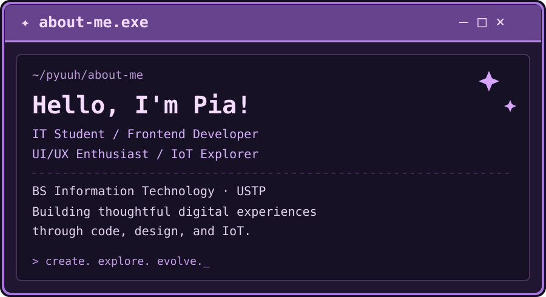

<div align="center">
  
</div>

<br>

<div align="center">

# ✦ Hello, I'm Pia! ✦

### IT Student | Developer | Tech Explorer

Welcome to my little corner of GitHub:p

</div>

---


<!-- ABOUT ME -->

<h2 align="center">✦ A Little About Me ✦</h2>

<table>
  <tr>
    <td width="75%" align="center">
      
    </td>
    <td width="25%" align="center">
      
    </td>
  </tr>
</table>

```javascript
const pia = {
  role: "Information Technology Student",
  university: "USTP",

  interests: [
    "Cybersecurity",
    "Internet of Things",
    "UI/UX Design",
    "Software Development"
  ],

  currentlyLearning: [
    "Web Development",
    "IoT Technologies",
    "Information Security"
  ],

  philosophy: "Create. Explore. Evolve."
};
```

<br>


<!-- TECH STACK -->

<h2 align="center">✦ Tech Stack ✦</h2>

<h3 align="center">⌘ Languages & Markup</h3>

<p align="center">
  
</p>

<p align="center">
  <code>Python</code> ·
  <code>JavaScript</code> ·
  <code>Java</code> ·
  <code>HTML5</code> ·
  <code>CSS3</code>
</p>

<br>

<h3 align="center">⌘ Frameworks & Development</h3>

<p align="center">
  
</p>

<p align="center">
  <code>React Native</code> ·
  <code>React</code> ·
  <code>Django</code> ·
  <code>Node.js</code>
</p>

<br>

<h3 align="center">⌘ Tools & Databases</h3>

<p align="center">
  
</p>

<p align="center">
  <code>Git</code> ·
  <code>GitHub</code> ·
  <code>VS Code</code> ·
  <code>MySQL</code> ·
  <code>Figma</code> ·
  <code>Postman</code>
</p>

<br>

<h3 align="center">⌘ Exploring & Learning</h3>

<p align="center">
  
</p>

<p align="center">
  <code>Internet of Things</code> ·
  <code>Cybersecurity</code> ·
  <code>Linux</code> ·
  <code>Docker</code>
</p>


<p align="center">
  
</p>

<br>

<!-- END TECH STACK -->
